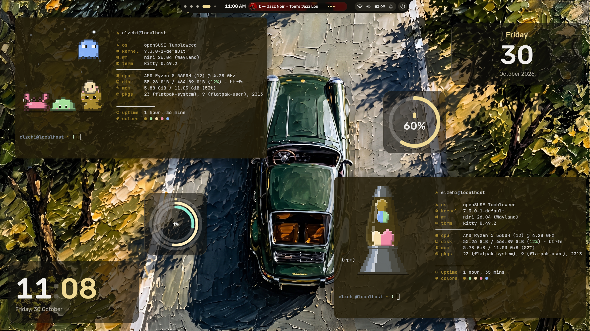
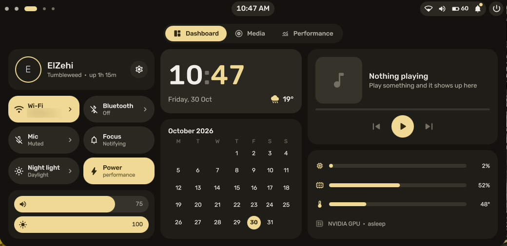
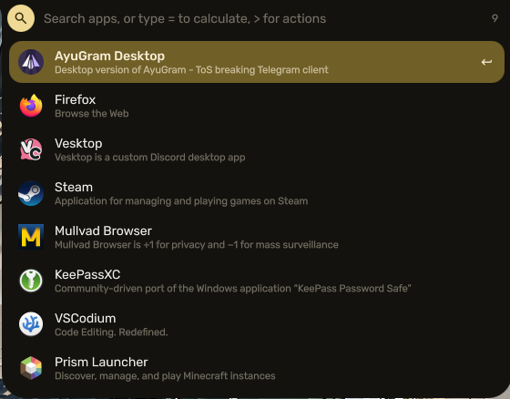
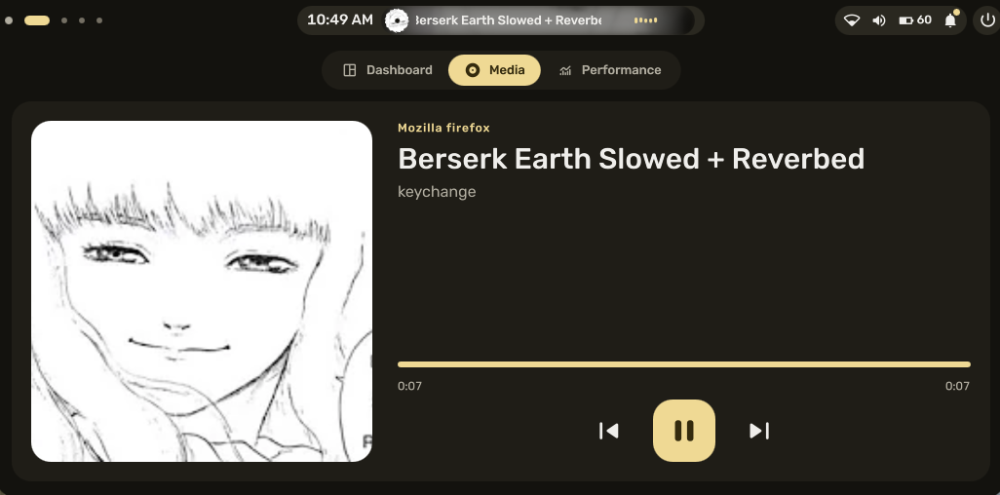
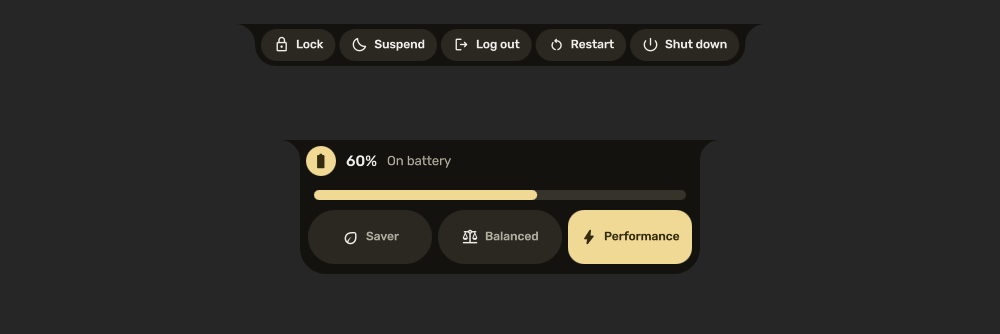
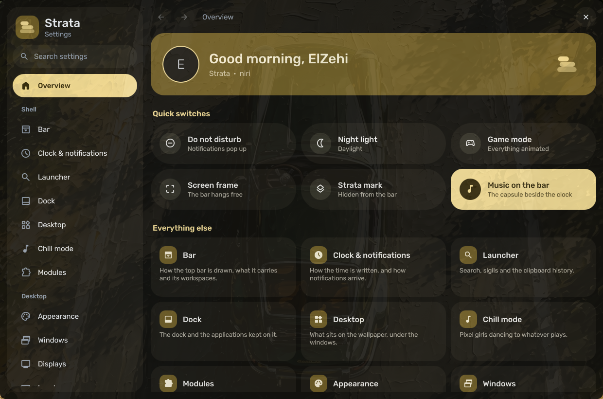
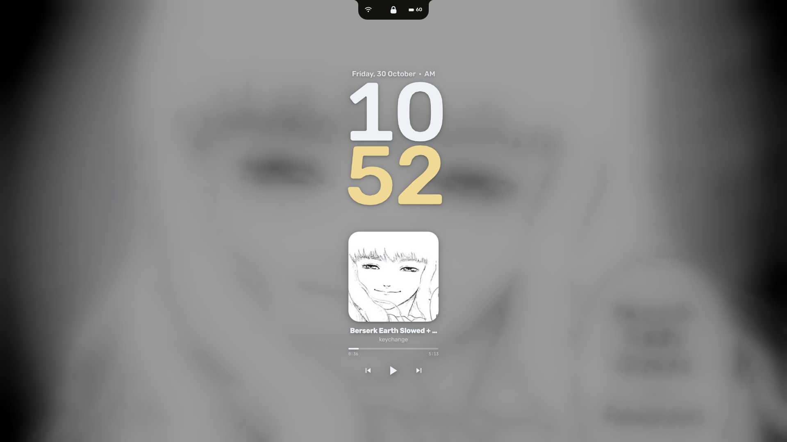

<div align="center">


# Strata

**A desktop shell for openSUSE Tumbleweed and Niri.**

A floating bar that turns into whatever you open, with a dashboard, launcher,
lock screen, login screen and desktop widgets, all coloured from your
wallpaper.


[Screenshots](#screenshots) · [Features](#features) · [Install](#install) · [Keys](#keys) · [Configuration](#configuration) · [Credits](#credits)

</div>

## Screenshots



<table>
  <tr>
    <td></td>
    <td></td>
  </tr>
  <tr>
    <td align="center"><b>Dashboard</b>: quick toggles, media and system stats</td>
    <td align="center"><b>Launcher</b>: the bar grows into a search</td>
  </tr>
  <tr>
    <td></td>
    <td></td>
  </tr>
  <tr>
    <td align="center"><b>Music</b>: cover, title and progress on the bar</td>
    <td align="center"><b>Power menu and battery</b>: the bar becomes the tool</td>
  </tr>
  <tr>
    <td></td>
    <td></td>
  </tr>
  <tr>
    <td align="center"><b>Settings</b>: an overview, quick switches and every page</td>
    <td align="center"><b>Lock screen</b> and a matching login screen</td>
  </tr>
</table>

## Features

**The bar**
- Floats at the top centre and is never full width.
- Turns into the tool you open (Wi-Fi, Bluetooth, battery, notifications,
  launcher, power menu) instead of opening a separate popup.
- Shows the playing track with its cover and progress, and grows into a
  media capsule.
- Has the tray beside the status icons. Volume and brightness changes and
  notifications appear in the bar itself.

**The dashboard**
- Toggles for Wi-Fi, Bluetooth, the microphone, do not disturb and night light.
- Media controls with a visualiser.
- CPU, memory, GPU and temperatures.

**The rest of the desktop**
- **Launcher**: apps, a calculator, commands, the clipboard history and emoji.
- **Desktop widgets**: a clock, weather, calendar, media and system cards that
  you can place on the wallpaper.
- **Lock screen** and an **SDDM login screen** in the same style.
- **Notes, tasks, timers, screen recording, screenshots and a colour picker**,
  all reachable from keys or the launcher.

**Theming**
- Every colour comes from the wallpaper. One change recolours the shell,
  kitty, GTK and Qt apps, btop and the login screen.
- Built on Rubik and Material Symbols, with rounded tonal surfaces and
  animations that open slowly and close fast.

**Settings**
- An Overview page with quick switches and a card for every page.
- Search, back and forward history, and keyboard navigation.
- Niri's own files are listed by topic, with a button to check the config
  without leaving the window.

## Install

> [!IMPORTANT]
> Strata targets **openSUSE Tumbleweed** with **Niri 26.04 or later** and
> **Quickshell 0.3 or later**. Run the installer as your normal user from a
> local terminal; it asks for sudo when it needs root.

```sh
git clone https://github.com/Agapenordev/Strata ~/strata
cd ~/strata
./install
```

The installer:

1. installs the desktop and asks about each optional group (Enter takes the
   suggestion);
2. shows the full plan and waits for a yes;
3. backs up every file it replaces, and takes a Snapper snapshot before system
   changes when Snapper is set up;
4. checks the Niri config before it finishes.

Then log out, pick the **Niri** session, and log in.

### Optional groups

| Group | What it adds | Suggested |
| --- | --- | --- |
| `login` | Strata's login screen (SDDM), matching the lock screen | yes |
| `apps` | Dolphin, Firefox, Kate, Okular, KeePassXC, LibreOffice | yes |
| `media` | swayimg, imv, mpv and VLC | yes |
| `terminal` | zsh with starship, fastfetch and btop, all themed | yes |
| `power` | power-saver on battery, balanced or performance on AC | on laptops |
| `nvidia` | openSUSE's signed open NVIDIA driver; the desktop stays on the other GPU | with an NVIDIA card |

### Installer options

```sh
./install --dry-run                    # show the plan, change nothing
./install --yes                        # take the suggestions without asking
./install --with gaming --without apps
./install --groups                     # what can be chosen on this machine
./install --doctor                     # read-only health check
./install --restore STAMP              # undo a run (the stamp is printed at the start)
```

### Updating

```sh
cd ~/strata && git pull && ./install
```

Files you have changed in `~/.config/niri/local.kdl` are never replaced.

## Keys

`Mod` is the Super key. Press **Mod+Shift+/** to see every binding.

| Key | Action | | Key | Action |
| --- | --- | --- | --- | --- |
| `Mod+Space` | Launcher | | `Mod+Return` | Terminal |
| `Mod+I` | Dashboard | | `Mod+E` | Files |
| `Mod+Comma` | Settings | | `Mod+B` | Browser |
| `Mod+V` | Clipboard | | `Mod+A` | Close window |
| `Mod+Semicolon` | Emoji | | `Mod+F` | Maximise column |
| `Mod+N` | Notes | | `Mod+Ctrl+F` | Fullscreen |
| `Mod+X` | Power menu | | `Mod+Alt+Space` | Float / tile |
| `Mod+Ctrl+L` | Lock | | `Mod+Tab` | Overview |
| `Mod+G` | Game mode | | `Mod+1` to `Mod+0` | Workspaces 1–10 |
| `Print`, `Mod+Shift+S` | Screenshot a region | | `Mod+Alt+D` | Record the screen |

## Configuration

Most things are in **Settings** (`Mod+Comma`). Niri's own config is split into
one file per topic:

```
~/.config/niri/
├── config.kdl          only include lines
├── input.kdl           keyboard, touchpad, mouse
├── display.kdl         screens
├── environment.kdl     session environment
├── startup.kdl         services started with the session
├── layout.kdl          gaps, column widths, shadows
├── general.kdl         cursor, overview, screenshots
├── animations.kdl      springs and curves
├── workspaces.kdl      workspaces 1–10
├── switcher.kdl        Alt+Tab
├── rules/              window rules: general, floating, browsers, gaming, privacy
├── binds/              keys: apps, shell, windows, workspaces, media, system
└── local.kdl           this machine only
```

`local.kdl` is read last, so anything in it wins. The installer creates it
once and never overwrites it. Put your keyboard layout, screens, GPU and your
own keys there.

<details>
<summary><b>What is in this repository</b></summary>

| Path | What it is |
| --- | --- |
| `home/.config/quickshell/` | The shell: bar, dashboard, panels, lock screen, services and scripts |
| `home/.config/niri/` | The Niri config described above |
| `home/.config/…` | kitty, zsh, starship, btop, cava, fastfetch, GTK, Qt and portals |
| `home/.local/bin/` | `strata` (shell CLI), `strata-power` (AC/battery profiles), `nvidia-run` |
| `system/` | The SDDM theme and the optional system drop-ins |
| `packages/` | `core.txt` for the desktop, one file per optional group |
| `install` | The installer |
| `tests/` | Installer dry run, a nested-Niri smoke test, theming tests |

</details>

<details>
<summary><b>Troubleshooting</b></summary>

- **The bar does not appear:** run `systemctl --user status strata` and
  `journalctl --user -u strata -e`.
- **Something looks stuck:** restart the shell with `Mod+Ctrl+Shift+R`, or use
  Settings → Overview → Restart.
- **A Niri change did nothing:** Settings → Overview → Check, or run
  `niri validate`.
- **Everything else:** `./install --doctor` checks packages, services and
  config without changing anything.

</details>

## Credits

- [Impasto](https://github.com/andreumassanet/impasto) by Andreu Massanet. It
  was the Arch Linux + Hyprland shell that Strata began from; Strata ports it
  to openSUSE Tumbleweed and Niri and redesigns it.
- [Caelestia](https://github.com/caelestia-dots/shell), which inspired the
  dashboard and settings.
- [Quickshell](https://quickshell.org) and [Niri](https://github.com/YaLTeR/niri).
- [rishot](https://github.com/Gakuseei/rishot) (MIT), bundled for screenshots.
- Fonts: [Rubik](https://fonts.google.com/specimen/Rubik),
  [Material Symbols](https://fonts.google.com/icons),
  [JetBrains Mono Nerd Font](https://www.nerdfonts.com/) and Grape Nuts, all
  under the OFL or Apache 2.0.

## License

[GPL-3.0](LICENSE). Strata contains code derived from Impasto, which is
GPL-3.0, so Strata is distributed under the same license.
